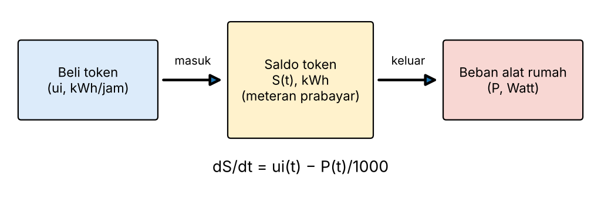
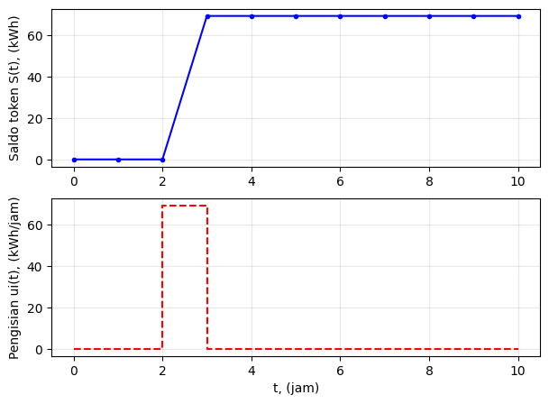
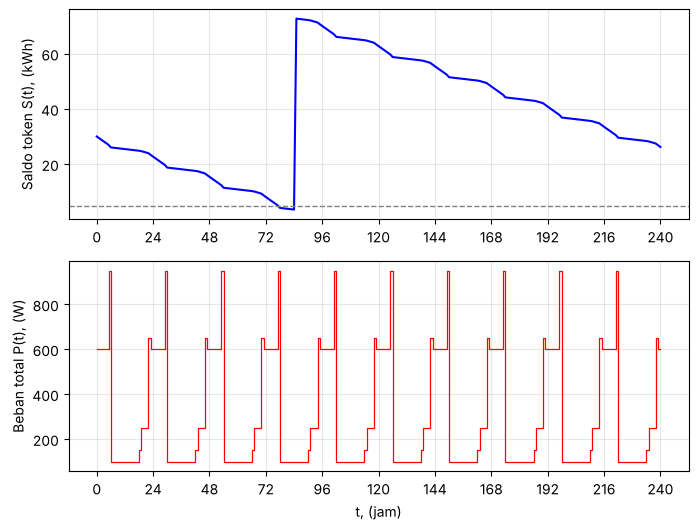
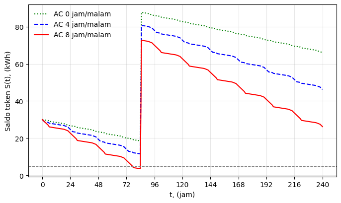
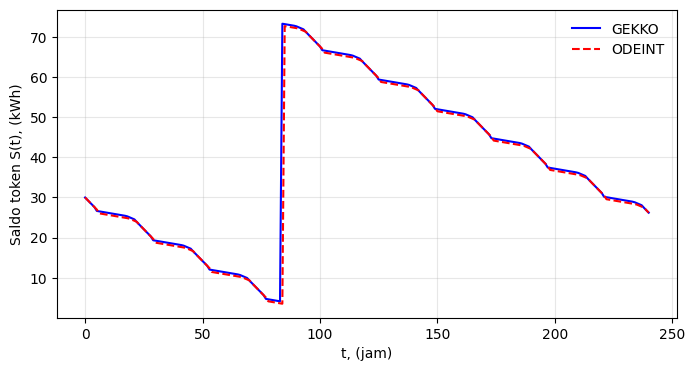
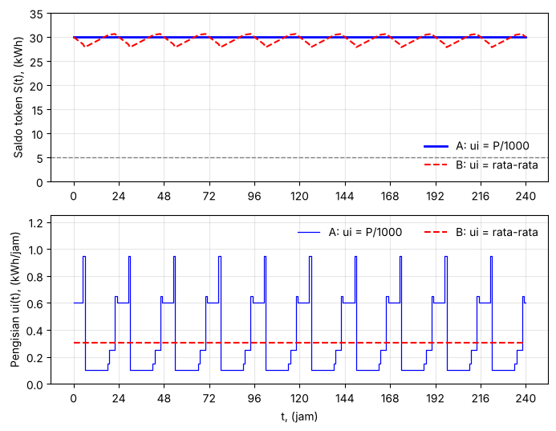

# Pemodelan dan Simulasi Sistem Dinamik: Saldo Token Listrik Prabayar di Rumah

[](https://colab.research.google.com/drive/1Q8Vo6ANXjZn0ulgHlZDuP5f0hf5rgi7T?usp=sharing)

Tugas praktikum **Pemodelan dan Simulasi** (Pertemuan 6: *Dynamic System Modelling*, TA-06), Teknik Informatika, Universitas Bale Bandung (UNIBBA).
Dosen pengampu: Mohammad Bayu Anggara, S.Kom., M.Kom.

| | |
|---|---|
| Nama | Rizki Hasan Fauzi |
| NIM | 301240071 |
| Kelas | 5B Teknik Informatika |
| Video tutorial | [YouTube]  |

## Deskripsi

Project ini memodelkan **saldo token listrik prabayar** di rumah sebagai sistem dinamik. Saldo token (kWh) diperlakukan seperti isi tangki cairan: pengisian token adalah *inlet*, dan pemakaian alat listrik adalah *outlet*. Simulasi dibuat dengan Python di Google Colab untuk melihat perubahan saldo dari jam ke jam, kapan saldo menyentuh batas peringatan, dan pengaruh lama pemakaian AC.



## Model

Sistem tidak bergantung pada ruang (spasial), sehingga berbentuk **ODE orde satu** dengan satu *state variable* (DOF = 0):

$$\frac{dS(t)}{dt} = u_i(t) - \frac{P(t)}{1000}$$

| Simbol | Arti | Satuan |
|---|---|---|
| $S(t)$ | Saldo token (state variable) | kWh |
| $u_i(t)$ | Pengisian token (input sinyal kontrol) | kWh/jam |
| $P(t)$ | Total daya alat yang sedang menyala | W |

Token Rp100.000 dengan tarif Rp1.444,70/kWh setara $E = 100.000 / 1.444{,}70 \approx 69{,}22$ kWh.

### Parameter (asumsi)

| Parameter | Nilai |
|---|---|
| Tarif listrik | Rp1.444,70/kWh |
| Nominal token | Rp100.000 (69,22 kWh) |
| Saldo awal (Model 2 dan 3) | 30 kWh |
| Batas peringatan saldo | 5 kWh |
| Langkah waktu / lama simulasi | 1 jam / 240 jam (10 hari) |
| Pengisian token | jam ke-84 |

| Alat | Daya | Jam nyala | kWh/hari |
|---|---|---|---|
| Kulkas (rata-rata) | 100 W | 24 jam | 2,40 |
| Lampu LED (5 × 10 W) | 50 W | 18.00 – 23.00 | 0,25 |
| TV | 100 W | 19.00 – 22.00 | 0,30 |
| Rice cooker | 350 W | 05.00 – 06.00 | 0,35 |
| AC | 500 W | 22.00 – 06.00 | 4,00 |
| **Total** | | | **7,30** |

Daya dan jadwal alat adalah estimasi. Sesuaikan dengan kondisi rumah masing-masing.

## Isi Notebook

`Pemodelan_Token_Listrik.ipynb` berisi lima program:

| Program | Isi | Hasil utama |
|---|---|---|
| 1 | Pengisian token tanpa pemakaian (analog tangki dengan outlet tertutup) | Saldo naik dari 0 ke 69,22 kWh saat pulse pengisian 1 jam, lalu tetap |
| 2 | Saldo dengan pemakaian alat rumah selama 10 hari | Pemakaian 7,3 kWh/hari. Saldo 3,55 kWh di jam ke-84, lalu 72,67 kWh setelah isi token |
| 3 | Variasi lama AC (0, 4, 8 jam per malam) | Saldo akhir 10 hari: 66,22 / 46,22 / 26,22 kWh |
| 4 | Versi GEKKO sebagai pembanding | Hampir berimpit dengan odeint (selisih < 1 kWh) |
| 5 | Simulasi steady state | Saldo tetap 30 kWh (kasus A) atau berulang tiap 24 jam (kasus B) |

### Hasil simulasi

| | |
|---|---|
|  |  |
| **Model 1:** pengisian token tanpa pemakaian | **Model 2:** saldo dengan pemakaian selama 10 hari |
|  |  |
| **Model 3:** pengaruh lama AC | **Program 4:** GEKKO vs odeint |

**Steady state (Program 5).** Steady state tercapai saat $dS/dt = 0$, yaitu $u_i = P/1000$. Kasus A: pengisian selalu sama dengan pemakaian sesaat, sehingga saldo tetap 30 kWh. Kasus B: pengisian konstan sebesar rata-rata pemakaian (0,304 kWh/jam), sehingga saldo naik-turun dalam sehari (27,88 – 30,64 kWh) dan kembali ke 30 kWh tiap 24 jam.



## Cara Menjalankan

**Google Colab (disarankan):** klik tombol *Open In Colab* di atas, lalu pilih *Runtime → Run all*.

**Lokal:**

```bash
git clone https://github.com/rizkihsn/Saldo-Token-Listrik-Prabayar-di-Rumah.git
cd Saldo-Token-Listrik-Prabayar-di-Rumah
pip install numpy scipy matplotlib gekko jupyter
jupyter notebook Pemodelan_Token_Listrik.ipynb
```

Library `gekko` hanya dipakai pada Program 4. Program lainnya cukup dengan `numpy`, `scipy`, dan `matplotlib`. Python 3.10 atau lebih baru.

## Struktur Repositori

```
.
├── Pemodelan_Token_Listrik.ipynb   # kode simulasi (Program 1-5)
├── Laporan_TA-06_...docx           # laporan project dan tutorial
├── README.md
└── images/                         # gambar hasil simulasi
```

## Referensi

- Andhika, L. R. (2019). *Model sistem dinamis: Simulasi formulasi kebijakan publik.* https://jurnal.dpr.go.id/index.php/ekp/article/download/1242/737
- Siradjuddin, I. (n.d.). *Pemodelan sistem dinamik.* https://www.researchgate.net/publication/359861380_Pemodelan_Sistem_Dinamik
- Modul Praktikum Pemodelan dan Simulasi, Modul 6: *Dinamic System Modelling*.
